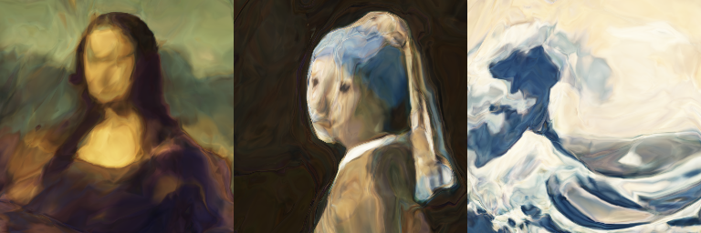

# iccnet

**A neural network inside an ICC color profile, run by an unmodified color engine.** The PNG
below holds no picture. Each pixel stores its own column in red, its row in green and a code in
blue, and the color profile embedded in the file holds a small trained network. An engine that
evaluates the profile paints three paintings. Your browser doesn't, so it shows the gradient.

<table>
<tr><th><code>gallery/trio.png</code>, as your browser shows it</th></tr>
<tr><td></td></tr>
<tr><th>The same file, converted to sRGB by ImageMagick</th></tr>
<tr><td></td></tr>
</table>

```sh
magick gallery/trio.png -profile "/System/Library/ColorSync/Profiles/sRGB Profile.icc" painted.png
```

Any sRGB profile will do as the target. Nothing in the file stores the painting's pixels. ICC v4
profiles can describe a device as a chain of *multiProcessElements*: matrices with offsets and sets
of per-channel curves, evaluated in float and never clipped between elements (ICC.1:2022 §10.16). A matrix followed by a set of curves is one layer of a neural network, and the curves are
its activations. iccnet trains a network from (x, y, code) to color within the limits that
LittleCMS, the engine inside most open-source imaging software, puts on those elements, and writes
it into the profile's DToB tags.

**[Open the interactive page →](https://claude.ai/artifact/3kSNePTe3VMEieVZ7Yjx4G)** It paints the gallery in your browser with its own
evaluator of the profile, which matches LittleCMS in double precision to within one code value and
its 33-point table to within three. It also has a slider over the code, every engine's output, and
the network read back from the file, element by element.

## What paints it

Measured on an Apple M4 with macOS 27.0.1, by `probe/engines.py gallery/trio.png`. Every
output is compared with LittleCMS evaluating the profile in double precision. Differences are in
8-bit code values, mean / max.

| Engine | Version | Result | Mean / max |
|---|---|---|---:|
| ImageMagick, `-profile` (double precision, its default) | 7.1.2-33, the official WebAssembly build | the paintings, exact | 0.25 / 0.5 |
| LittleCMS on float pixels; `tificc -c0`; Pillow's `ImageCms` with `Flags.NOOPTIMIZE` | LittleCMS 2.17, Pillow 11.2.1 | the paintings, exact | 0.25 / 0.5 |
| sharp, default pipeline; libvips `icc_transform` | sharp 0.35.5, libvips 8.18.7 (LittleCMS 2.19) | the paintings through a 33-point table | 8.64 / 176 |
| Pillow's `ImageCms.profileToProfile`, default flags; `tificc` | Pillow 11.2.1, LittleCMS 2.17 | the paintings through a 33-point table | 8.64 / 176 |
| ImageMagick with `-define profile:highres-transform=false` (16-bit) | 7.1.2-33 | the paintings through a 49-point table | 6.33 / 175 |
| macOS ColorSync, through Core Graphics, as Safari and Preview use it | macOS 27.0.1 | the gradient: DToB tags are not evaluated | |

An exact result is off by 0.5 at most, which is the rounding to an 8-bit file. The WebAssembly
build is Q8 without HDRI; builds with HDRI ignore the define and always convert in double
precision (`MagickCore/profile.c`).


From their source code, not run here:

| Application | What it shows, by its source |
|---|---|
| Chrome, Edge (skcms), Firefox (qcms) | the gradient: they read only A2B tags (skcms A2B0 or A2B1, qcms A2B0) or the matrix tags, which say plain sRGB |
| GIMP 3 | exact when converting an image (LittleCMS with `cmsFLAGS_NOOPTIMIZE`). The display transform of an 8-bit image keeps LittleCMS's optimizations by default, so the screen shows the table. babl, GIMP's own engine, leaves a profile to LittleCMS only when it has both A2B0 and B2A0 |
| Krita | exact for float images; integer images through a 49-point table (`cmsFLAGS_HIGHRESPRECALC`) |
| darktable, RawTherapee | exact: LittleCMS on float pixels. darktable's own matrix path is skipped because the profile has A2B tags |
| MuPDF, Ghostscript | a table: they build 8- and 16-bit links (17 and 49 points) |

## How it works

```
carrier pixel (R, G, B) = (column, row, code), each 0..255, read as 0..1
   │ D2B1, the relative-colorimetric tag: one multiProcessElements chain, float32
   ▼
matf 3→4      copies B into a fourth channel, the gate
cvst 4        gate = 1 where B ≤ 0, else 0; x, y, B pass through
matf 4→15     layer 1: 14 neurons, the gate carried along
cvst 15       14 learned activations, the gate passed through
   … 7 more layers like it …
matf 15→3     output layer, minus 1000 × gate
cvst 3        sigmoid: a sampled segment, 4,096 samples on [−12, 12]
cvst 3        sRGB decoding: two formula segments
matf 3→3      sRGB → XYZ (D50), the profile connection space
   │ the destination profile, e.g. sRGB
   ▼
screen pixel
```

**Layers.** A `matf` element is y = Wx + b. A `cvst` element applies one segmented curve per
channel: segments split at breakpoints, each either a formula (y = (ax + b)^γ + c) or evenly spaced
samples with linear interpolation, and the first and last must be formulas. ReLU is two linear
formula segments that meet at 0. A sine is one sampled segment of 16,384 points. A learned
activation is a piecewise-linear function with 64 knots on [−4, 4]. The profile stores it as one
sampled segment, then linear formula segments that continue its end slopes as far as any input in
[0, 1]³ can drive that neuron (bounded by interval arithmetic), and constants beyond. So it is
exact: LittleCMS's render of every trained profile matches PyTorch's to within 0.13 code values.

**Width.** LittleCMS reads matrices with at most 15 inputs and outputs, and the gate takes one
channel, so hidden layers are 14 wide. Depth is free, and a curve can hold any number of samples,
so capacity goes into the activations: each neuron learns its own.

**Tags.** The four DToB tags (one per rendering intent) point at the same bytes, because LittleCMS
reads the tag of the intent it is asked for and never falls back from one to another. Everything
else says plain sRGB:

| Tags | Type | For |
|---|---|---|
| D2B0–D2B3 | `mpet` | the network, then sRGB → XYZ: one copy, most of the 71 KB for the 8-layer network |
| rXYZ, gXYZ, bXYZ, rTRC, gTRC, bTRC | `XYZ `, `para` | engines that skip DToB (they show the pixels as sRGB); LittleCMS's intent checks and its black-point search |
| A2B0–A2B2, B2A0–B2A2 | `mAB `, `mBA ` | browsers; LittleCMS's intent checks; GIMP and darktable, which only send profiles with LUT tags to LittleCMS |
| desc, cprt, wtpt, chad | | description, copyright, D50 white, the D65 → D50 adaptation |

The header says v4.3, class display, PCS XYZ, perceptual intent, with an MD5 profile ID.
`python -m iccnet inspect gallery/trio.png` lists it all.

**Black, and the gate.** In the perceptual intent LittleCMS compensates black points whenever the
destination profile is v4, as its own sRGB is. To find a v4 source's black point it takes a fixed
dark gray (L\* 3.1), which moves colors by up to 8 code values, unless the profile has
matrix/TRC tags. Then it runs the profile on RGB (0, 0, 0). What it does when that isn't black has
changed from version to version. 2.14 clips L\* to 50, 2.16 and 2.17 treat anything above 50 as 0,
and 2.18 and 2.19 treat anything above 95 as 0 and clip what lies between 50 and 95 to 50. A black
point of L\* 50 makes mid-gray black. So the profile has the matrix tags, and a gate: one more channel that is 1
where blue is 0, carried through every layer and subtracted, times 1,000, before the sigmoid. The
plane blue = 0 is black and the codes 1 to 255 are untouched. The network is never trained on it.

**Training.** Each painting is one 256 × 256 tile, at a code of its own. Mean squared error on the
sRGB-encoded values, Adam with a one-cycle schedule (peak 3 × 10⁻³, 10⁻³ for sine), 8,000 steps
of 8,192 random pixels (12,000 for two and three paintings), on two CPU threads of an M4: 1.5 to
13 minutes a network. The learned activations start as ReLU. Sine networks use SIREN's
initialization, ω = 30.

## LittleCMS facts it depends on

Found with the probes in `probe/` and checked by `tests/`. LittleCMS 2.17 (Homebrew) and 2.19
(the copy inside sharp's libvips) gave the same numbers on every probe, except where noted.

- **DToB first.** A DToB tag takes precedence over A2B for its intent, and a missing D2B1 makes the
  relative intent use A2B1, not D2B0 (`test_each_intent_reads_its_own_dtob`).
- **Fewer than 16 channels.** A `matf` element with 16 inputs or outputs makes the tag unreadable
  (`test_sixteen_channels_are_rejected`).
- **Before 2.16, a formula segment clamps even when it is linear.** For y = (ax + b)^γ + c,
  LittleCMS 2.14 and 2.15 return c wherever ax + b < 0, even at γ = 1; 2.16 added an exception for
  γ = 1. Ubuntu 24.04 and Debian 12 ship 2.14, and CI on Ubuntu caught a test profile whose linear
  ends went negative (0.097 off in XYZ). So the writer measures every linear segment from the end
  where its base is 0, and the gallery paints the same under both rules
  (`test_older_littlecms_paints_the_same`).
- **Float pixels are evaluated exactly.** On float and double formats every element runs for every
  pixel, with float32 values between elements and no clipping. `probe/spike.py` runs a fixed
  3 → 8 → 3 network on all 65,536 (R, G) pairs at five values of B. At the XYZ connection space it
  matches a NumPy model of the same elements to float32 precision, and after conversion to sRGB to
  within 0.14 code values.
- **Integer pixels get a table.** On 8- and 16-bit formats LittleCMS samples the whole transform
  at 33 × 33 × 33 points (17 with `cmsFLAGS_LOWRESPRECALC`, 49 with `cmsFLAGS_HIGHRESPRECALC`) and
  interpolates (`probe/tables.py`). That costs the spike a mean of 0.09 code values on 16 bits, but a
  sine of 20 cycles across the image is lost: mean 72.7, max 166. The table is also pinned to white
  at RGB (1, 1, 1), which puts the corner up to 72 code values off (2.1 with
  `cmsFLAGS_NOWHITEONWHITEFIXUP`). `cmsFLAGS_NOOPTIMIZE` keeps the per-pixel evaluation: 0.14 code
  values on 16 bits, 0.63 on 8.
- **8-bit RGB to RGB may fit the gray axis first.** Before sampling the table, LittleCMS tries to
  fit a curve per channel to the transform's gray axis, and samples through those curves when they
  pass its checks. For a network the gray axis means nothing: the spike comes out 35 code values off
  on average (the worse channel of each pixel), against 0.38 with `cmsFLAGS_FORCE_CLUT`, which skips
  the fit. For every gallery profile the fit is refused, and the 8-bit result equals the
  `FORCE_CLUT` one exactly.
- **The intent checks ignore DToB.** `cmsIsIntentSupported` looks at A2B tags and matrix/TRC tags
  only, so a profile with DToB tags alone supports no intent (`test_intent_checks_ignore_dtob`).
  libvips, and with it sharp, then converts with its built-in sRGB instead, by its source.
- **Black point compensation runs the profile at black**, as described above (`probe/bpc.py`). Max
  difference from the relative-colorimetric render, in the perceptual intent, to LittleCMS's sRGB:

  | Profile | LittleCMS 2.17 | 2.19 |
  |---|---:|---:|
  | as published: gate, matrix and LUT tags | 0.00 | 0.00 |
  | no gate (RGB 0, 0, 0 paints L\* 86) | 0.00 | 42.70 |
  | gate, LUT tags only | 8.02 | 8.02 |
  | gate, DToB tags only | 8.02 | 8.02 |

  To a v2 sRGB profile like the one macOS ships, the published layout is 0.00 too, with and
  without `cmsFLAGS_BLACKPOINTCOMPENSATION`.
- **A typo in the spec.** ICC.1:2022 Table 57 gives the curve set's signature 'cvst' as 6D666C74h,
  which spells 'mflt'. LittleCMS uses 63767374h, which is right.

## How much fits

One painting, the Mona Lisa at 256 × 256, by networks of 14-wide layers (`train_all.py`). PSNR
against the painting, for LittleCMS's exact render and for its 33-point table (8 and 16 bits give
the same, to within rounding):

| Network | Parameters | Profile | Exact | Through the table |
|---|---:|---:|---:|---:|
| ReLU, depth 8 | 1,571 | 25 KB | 23.98 dB | 23.68 dB |
| sine, depth 8 | 1,571 | 89 KB | 26.62 dB | 25.55 dB |
| learned curves, 64 knots, depth 4 | 4,315 | 44 KB | 27.56 dB | 25.74 dB |
| learned curves, 64 knots, depth 8 | 8,739 | 71 KB | **28.42 dB** | 25.79 dB |
| learned curves, 64 knots, depth 12 | 13,163 | 97 KB | 28.01 dB | 25.72 dB |
| learned curves, 16 knots, depth 8 | 3,363 | 50 KB | 27.47 dB | 25.69 dB |
| learned curves, 256 knots, depth 8 | 30,243 | 155 KB | **28.83 dB** | 25.76 dB |


Learned activations matter most. With the same layers, ReLU reaches 24.0 dB, a sine 26.6 and
learned curves 28.4. More knots help a little (256 knots: 28.8 dB, at 155 KB); depth 12 did worse
than 8 in the same 8,000 steps. Through the table every network but ReLU lands between 25.5 and
25.8 dB: there the table sets the quality, not the network.


The fourteen learned activations of layer 4 of the 8-layer network, as the profile stores them.

The gallery (`gallery/`, listed in [gallery/README.md](gallery/README.md)):

| File | Paintings, at codes | Exact | Through the table |
|---|---|---:|---:|
| `mona.png` | Mona Lisa, 128 | 28.4 dB | 25.8 dB |
| `pearl.png` | Girl with a Pearl Earring, 128 | 28.2 | 21.3 |
| `wave.png` | The Great Wave, 128 | 18.7 | 15.2 |
| `duet.png` | Mona Lisa 16, Pearl Earring 239 | 27.1, 26.6 | 25.6, 21.4 |
| `trio.png` | Mona Lisa 32, Pearl Earring 128, Great Wave 224 | 26.0, 24.7, 17.0 | 25.0, 21.2, 15.4 |
| `lowpoly.png` | Mona Lisa, 128, by the ReLU network | 24.0 | 23.7 |

Each is one network of 8 layers of 14 with learned curves (8,739 parameters, a 71 KB profile, a
31 KB PNG), except `lowpoly.png`. Sharing the same parameters costs each painting 1.4 to 1.6 dB
for two and 1.7 to 3.6 dB for three, against a network of its own.

## Prior work

- iccMAX (ICC.2) extends multiProcessElements with "a programmable calculator element" (ICC.1:2022,
  annex on ICC.2), and Kothari et al., *Capturing the iccMAX calculatorElement: A Case Study on
  Format Design* (IEEE Security and Privacy Workshops 2022), formalize it. That is computation by
  design, in ICC.2; iccnet uses only ICC.1's matrices and curves.
- P. Morovič, J. Morovič et al., *Color Scrambling for Secure Digital Content Distribution* (IS&T
  Color and Imaging Conference 2010): a pair of ICC profiles acts as public and private key, and the
  color engine decodes the image. The engine reveals content there too, but by remapping colors.
- Networks turned into color tables, and tables into networks: Drakopoulos and Subbarayan,
  [US 6,480,299](https://patents.google.com/patent/US6480299B1/en) (filed 1998), generate a printer
  profile's lookup table with a trained network; NILUT (Conde et al., AAAI 2024,
  [arXiv:2306.11920](https://arxiv.org/abs/2306.11920)) replaces 3D lookup tables with a small MLP.
  Neither stores a network's layers in a profile.
- X. Snelgrove and M. Tesfaldet, [*Interactive CPPNs in GLSL*](https://wxs.ca/research/cppn-to-glsl/)
  (2018): the same kind of coordinate network, compiled into shaders.
- Programs in file formats: [llama.ttf](https://github.com/fuglede/llama.ttf), a font that runs a
  language model through HarfBuzz's WebAssembly shaper, and [doompdf](https://github.com/ading2210/doompdf),
  Doom in a PDF's JavaScript. Here there is no script and no virtual machine, only data that the
  engine evaluates as it was designed to.
- Images that differ by viewer: [hdr-steganography](https://github.com/derenrich/hdr-steganography)
  shows a second image on HDR displays through an Ultra HDR gain map.

I found no published network stored in an ICC profile and run by an unmodified color engine.

## Limits

- **No browser paints it.** Safari's ColorSync doesn't evaluate DToB tags (measured), and Chrome's
  skcms and Firefox's qcms don't read them (by their source). The interactive page paints with its
  own evaluator.
- **Most pipelines see a table.** Integer pixels through LittleCMS take the 33-point table: fine
  lines blur, edges turn to blocks, and the Mona Lisa stays near 25.7 dB however good the network.
  Exact: ImageMagick, LittleCMS on float pixels, or `cmsFLAGS_NOOPTIMIZE`.
- **14 neurons a layer**, from LittleCMS's limit of 15 channels less the gate. Other engines that
  read multiProcessElements may allow more or fewer; none was tested.
- **Small pictures.** 256 × 256 per code at about 28 dB for the portraits; The Great Wave's foam
  lines bring it to 18.7 dB.
- **Blue = 0 is black**, the gate's plane. Codes 1 to 255 are free, and between the trained codes
  the network paints its own blends.
- **Tested on one Mac.** LittleCMS 2.17 and 2.19 were run; CI runs the tests on Ubuntu 24.04's
  2.14. What other applications do is from their current source, read in October 2026. Windows
  (WCS) and Adobe's color engine are unknown.

## Rebuild

Needs Python 3.10+ with NumPy and Pillow (PyTorch for training: `pip install -r
requirements.txt`), and LittleCMS 2 (`brew install little-cms2`, `apt install liblcms2-2`; set
`LCMS2` to a library path to use another build). Run everything from the repository root.

```sh
python -m pytest tests            # the profiles against LittleCMS, and the facts above
python train_all.py               # the 11 networks, three at a time: runs/ (32 minutes on an M4)
python publish.py                 # gallery/, results/capacity.json, docs/images/
python probe/spike.py             # the first experiment: a fixed 3 → 8 → 3 network on every path
python probe/tables.py            # the integer paths; writes probe/sine.png
python probe/bpc.py               # black point compensation by profile layout
python probe/engines.py gallery/trio.png --json results/engines.json --save-dir results/engines \
    --figure docs/images/engines.png --figure-engines colorsync,imagemagick,sharp
python pages/build.py             # the interactive page: pages/dist/

python -m iccnet train --paintings mona,pearl --codes 64,192 --name mine   # runs/mine.{icc,png,npz,json}
python -m iccnet inspect gallery/trio.png      # header, tags and DToB elements
python -m iccnet render gallery/trio.png out.png --path 16    # paint it with LittleCMS
```

`probe/engines.py` runs whatever it finds: Pillow always, `tificc` when it is on the PATH
(Homebrew's little-cms2 has it), ImageMagick and sharp if `NODE_MODULES_ROOT` names a directory where
`npm install sharp @imagemagick/magick-wasm` was run, libvips if `VIPS_PYTHON` is a Python with
`pyvips[binary]`, and ColorSync if `COLORSYNC_PROBE` is the binary from
`swiftc -O probe/colorsync.swift -o colorsync`. The probes' output is in `results/probes.txt`.

## Files

| File | Role |
|---|---|
| `iccnet/icc.py` | the profile writer: segmented curves, `matf`/`cvst`/`mpet`, the gate, the published tag layout, and `forward()`, which evaluates elements as the profile encodes them |
| `iccnet/model.py` | the networks (ReLU, sine, learned piecewise-linear) and their export to elements |
| `iccnet/train.py` | paintings, carriers, training, and the checks against LittleCMS |
| `iccnet/lcms.py` | an unmodified LittleCMS through ctypes |
| `iccnet/png.py`, `iccnet/read.py` | PNG with an embedded profile; reading profiles back |
| `iccnet/__main__.py` | `python -m iccnet train / carrier / render / inspect` |
| `train_all.py`, `publish.py` | the networks above; the gallery, figures and `results/capacity.json` |
| `probe/` | the experiments behind the facts above, and one harness per engine |
| `tests/` | pytest, and the page's evaluator against LittleCMS (`eval.mjs`) |
| `pages/` | the interactive page: `iccnet.js` (profile reader and evaluator), the template, `build.py` |
| `gallery/` | the carriers, each with its profile embedded, and their weights |
| `results/` | measured figures (`capacity.json`, `engines.json`), each engine's output, the probes' output |
| `paintings/` | the three paintings, public domain |

## License

MIT, Fedir Yudin. The paintings are Leonardo's, Vermeer's and Hokusai's, in the public domain, from
Wikimedia Commons ([paintings/README.md](paintings/README.md)).
