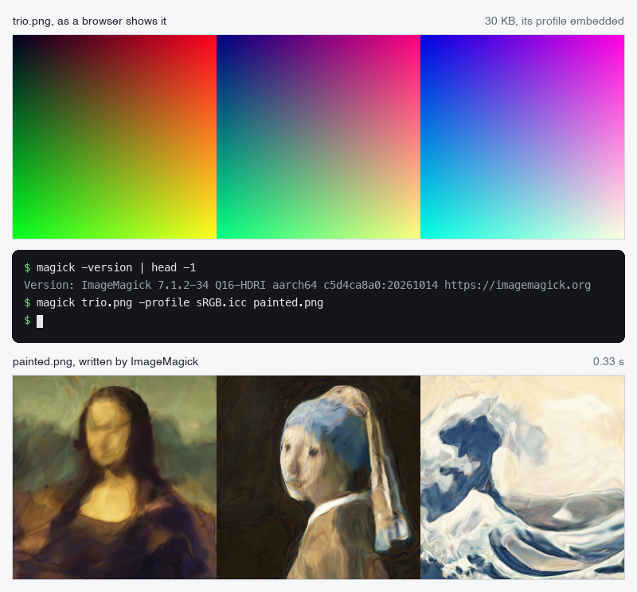
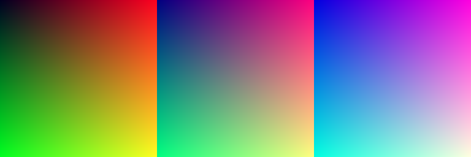
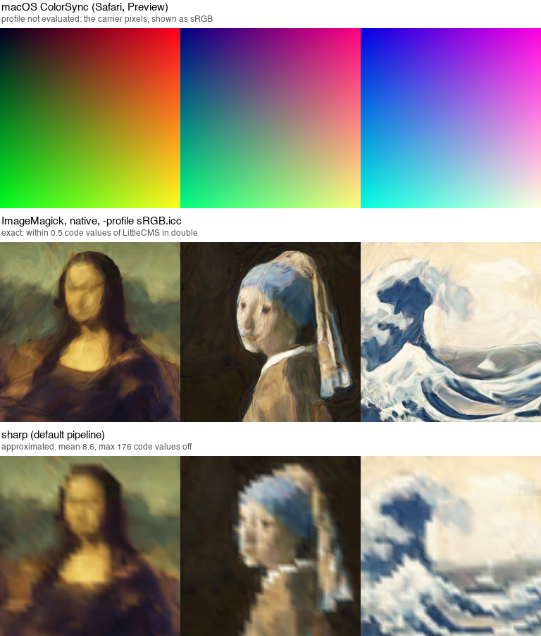
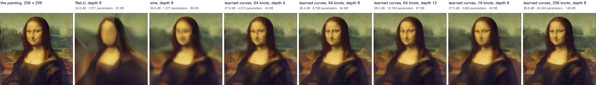
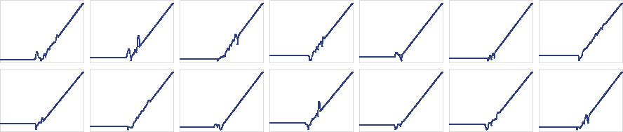

# iccnet

**These PNGs are gradients. Their color profiles are neural networks.** Ask ImageMagick to
convert one to sRGB, and the color engine, doing nothing but its ordinary job, paints the Mona
Lisa.



<sub>A real run of the command, drawn by <a href="record.py"><code>record.py</code></a> from the run's own input, output, version line and timing. It is not a screen capture.</sub>

**[Try it in your browser →](https://fmindstormer.github.io/iccnet/)** &nbsp;·&nbsp;
[Reproduce it](#reproduce-it) &nbsp;·&nbsp;
[Download the release](https://github.com/fMindstormer/iccnet/releases/tag/v1.0.0)

Every pixel of the file stores where it is: red counts the columns, green counts the rows, and
blue is a number that picks a painting. The file also carries an ICC color profile, the block of
data that tells software how a camera or a screen reproduces color. This one describes no real
device. Its 71 KB hold a trained network of 8,739 numbers, written in the vocabulary profiles use
to describe devices: matrices and curves. A color engine converting the file runs those matrices
and curves on every pixel, which means it runs the network, and the gradient turns into three
paintings. Nothing in the file is code, and no engine was modified.

## Where it works

- **Browsers show the gradient.** Chrome, Safari and Firefox skip the part of the profile that
  holds the network (its DToB tags), so they show the pixels as they are stored. GitHub is showing
  you the real file right here, profile and all:

  

- **Color engines that read those tags paint the pictures.** ImageMagick runs the network on
  every pixel, exactly. Pillow, sharp and libvips by default go through a 33-point table instead,
  and paint the pictures blocky ([what each engine does](#what-paints-it)).
- **The [interactive page](https://fmindstormer.github.io/iccnet/) brings its own evaluator.** It
  reads the profile from the PNG and runs it in JavaScript, which matches LittleCMS to within one
  code value. Your browser's color management plays no part in it. The page also lets you slide
  blue between the paintings and takes the network apart element by element.

## Reproduce it

No training, no Python: one ImageMagick command converts a carrier to the repository's plain sRGB
profile, and a second compares the result with the expected painting.

```sh
git clone https://github.com/fMindstormer/iccnet && cd iccnet
magick gallery/trio.png -profile sRGB.icc painted.png      # ImageMagick 7
convert gallery/trio.png -profile sRGB.icc painted.png     # ImageMagick 6
magick compare -metric AE -fuzz 1% painted.png results/expected/trio.png null:    # prints 0 (0)
compare -metric AE -fuzz 1% painted.png results/expected/trio.png null:           # 6: prints 0
```

| ImageMagick, native | Where | LittleCMS | Against `results/expected/trio.png` |
|---|---|---|---|
| 7.1.2-34 Q16-HDRI | Homebrew, macOS 27.0.1, Apple M4 | 2.19.1 | max 1 code value (3 rounding ties of 589,824 values) |
| 6.9.12-98 Q16 | Ubuntu 24.04 (apt), in CI on every push | 2.14 | max 1 code value |

`sRGB.icc` is a plain sRGB display profile of 540 bytes (ICC v4, three colorants and three tone
curves, written by `iccnet.icc.srgb_profile()`), so the command needs nothing from the operating
system. macOS's own sRGB profile or LittleCMS's built-in one paint the same to within 0.05 code
values. `results/expected/` holds each carrier as LittleCMS paints it in double precision, and
through its 33-point table (`<name>-table.png`). The
[v1.0.0 release](https://github.com/fMindstormer/iccnet/releases/tag/v1.0.0) bundles the six
carriers, `sRGB.icc`, the expected outputs, every engine's result and `SHA256SUMS`, and
[REPRODUCE.md](REPRODUCE.md) covers Pillow and the other engines.

## The machine

### Color management in one paragraph

When software shows an image that carries a profile, it converts every pixel from the image's
colors to the screen's. The conversion passes through a fixed reference space, the *profile
connection space* (PCS: CIE XYZ or L\*a\*b\* under a D50 illuminant). The image's profile maps its
pixel values into the PCS, and the screen's profile maps the PCS onto the screen. A typical profile
does its half with a 3 × 3 matrix and three tone curves, or with a lookup table.

In 2006 the ICC added a third way, which has been part of the main specification since ICC.1:2010
(profile version 4.3): a *multiProcessElements* pipeline, stored in four DToB tags, one per
rendering intent ([ICC.1:2022](https://www.color.org/specification/ICC.1-2022-05.pdf) §10.16;
[ICC White Paper 28](https://archive.color.org/files/whitepapers/ICC_White_Paper28-MultiProcessingElements.pdf)).
It was meant for floating-point and HDR data. It is also, looked at sideways, a small programming
language.

### The instruction set

A pipeline is a list of elements. Each element takes the previous one's channels and produces its
own, and ICC.1 defines three kinds:

| Element | Computes | Stored as |
|---|---|---|
| `matf`, matrix | y = Wx + b, from p channels to q | float32 W and b |
| `cvst`, curve set | yᵢ = fᵢ(xᵢ): one function per channel, each channel on its own | a segmented curve per channel |
| `clut`, lookup table | multilinear interpolation in a grid, inputs clamped to [0, 1] | float32 samples (not used here) |

A segmented curve splits the number line at breakpoints. Each piece is either a formula, one of
y = (ax + b)^γ + c, y = a·log₁₀(bx^γ + c) + d and y = a·b^(cx + d) + e, or a run of evenly
spaced samples joined by straight lines. The first and the last piece must be formulas, so a curve
is defined for every real number.

That is the whole language. There are no loops, branches, variables or memory. An element cannot
see any pixel but its own, and the number of steps is fixed. Two rules make it usable for
computing: values pass between elements as float32, and the specification forbids clipping them,
so an intermediate value can be −7 or 63 and survive. The pipeline is a straight-line program
from three numbers to three numbers, run once per pixel.

The boundary is fixed too. Three numbers go in, the pixel's red, green and blue as values from 0
to 1. Three numbers come out, the color in the PCS, and the screen's profile takes it from there.
And one engine sets the size of everything in between: LittleCMS, the color engine inside most
open-source imaging software, refuses elements with 16 or more channels. A layer can be 15 wide.

### Why it can draw

Read a matrix as a layer's weights and a curve set as its activation functions, and a pipeline is
a multilayer perceptron, one in which every neuron may have an activation of its own. Narrow
networks like that are universal. With ReLU activations, width 6 is enough to approximate any
continuous function from [0, 1]³ to three color channels, given enough layers ([Hanin and Sellke,
2017](https://arxiv.org/abs/1710.11278)). With almost any other activation, width 8 is enough
([Kidger and Lyons, 2020](https://arxiv.org/abs/1905.08539)). The format allows as many layers as
you like. So, in principle, a profile can paint any picture. In practice the limits are the 15
channels, the training, and what each engine does with the pipeline.

### Where the picture comes from

A pipeline sees one pixel and nothing else, so it cannot know where that pixel is. The image has
to tell it: red is the column, green is the row, and blue picks the painting. The profile then
computes color from position. Machine learning calls such a function a *coordinate network* or
an *implicit neural representation*; its ancestor is the CPPN ([Stanley,
2007](https://doi.org/10.1007/s10710-007-9028-8)). With 8-bit channels, each painting is one
256 × 256 tile, and blue has room for 255 of them.

Storing the picture would have been easier. A `clut` element could hold one painting as a table
of 255 × 255 points, about 1.5 MB of samples. iccnet uses no tables: it computes three paintings
in 71 KB.

## Building the network

**Layers.** Each hidden layer is a `matf` followed by a `cvst`. The activations are segmented curves:

- **ReLU** is two formula pieces that meet at 0: y = 0, then y = x.
- **Sine**, as in SIREN ([Sitzmann et al., 2020](https://arxiv.org/abs/2006.09661)), is one
  sampled piece of 16,384 points over the range the pre-activations reach.
- **Learned curves** give each neuron its own piecewise-linear function, 64 evenly spaced knots on
  [−4, 4], trained by gradient descent like any weight (per-neuron learned activations go back to
  [Agostinelli et al., 2015](https://arxiv.org/abs/1412.6830); [KANs](https://arxiv.org/abs/2404.19756)
  put learned functions on every edge instead).

A sampled piece is evenly spaced samples joined by straight lines, which is exactly a
piecewise-linear function with evenly spaced knots. So PyTorch trains the very function the color
engine evaluates, with nothing approximated on export. LittleCMS's render of every trained profile
matches PyTorch's to within 0.13 code values.

**Spend on curves, not channels.** Fifteen channels is a hard wall, but a curve can hold any number
of samples. So the capacity goes into the activations. In the 8-layer network, 7,168 of the 8,739
learned numbers are curve samples, and the learned curves beat ReLU by 4.4 dB with matrices of the
same shape (below).

**The way out.** The network ends in a sigmoid, a sampled piece of 4,096 points on [−12, 12], so
every color stays within [0, 1]. A profile must hand over PCS values, not screen colors, so two
more elements follow: the sRGB decoding curve (two formula pieces, a line and a 2.4 power) and the
matrix from linear sRGB to XYZ under D50. The screen's sRGB profile undoes both, and what reaches
the screen is the network's output.

```
carrier pixel (R, G, B) = (column, row, code), each 0..255, read as 0..1
   │ D2B1, the relative-colorimetric tag: one multiProcessElements chain, float32
   ▼
matf 3→4      copies B into a fourth channel, the gate
cvst 4        gate = 1 where B ≤ 0, else 0; x, y, B pass through
matf 4→15     layer 1: 14 neurons, the gate carried along
cvst 15       14 learned activations, the gate passed through
   … 7 more layers like it …
matf 15→3     output layer, minus 1000 × gate
cvst 3        sigmoid
cvst 3        sRGB decoding
matf 3→3      sRGB → XYZ (D50), the profile connection space
   │ the destination profile, e.g. sRGB
   ▼
screen pixel
```

Twenty-two elements: 11 matrices and 11 curve sets. LittleCMS runs them at about 230,000 pixels a
second on one core of an Apple M4. That is 0.86 s for the trio file, in double precision.

**Training.** Each painting is one tile of coordinates at a code of its own. The loss is mean
squared error on sRGB values. The optimizer is Adam with a one-cycle schedule (peak 3 × 10⁻³,
10⁻³ for sine). Each run takes 8,000 steps of 8,192 random pixels, or 12,000 steps for two or
three paintings, on two CPU threads of an M4: 1.5 to 13 minutes per network, 32 minutes for all
eleven, three at a time. The learned curves start out as ReLU.

## Getting past the color engine

A color engine is not a neutral interpreter. It chooses which tags to read, it rewrites pipelines
it thinks it can speed up, and it probes profiles with special colors. Each of these broke the
picture at some point. Here is what the profile does about each.

**It reads only the tag for the intent it is asked for.** LittleCMS takes the DToB tag of the
requested rendering intent and never falls back from one to another. A profile with only D2B0
paints in the perceptual intent and, in the relative one, falls back to its plain A2B1. So all four
tags point at the same bytes: one copy of the network, four ways in.

**It asks the old tags whether the profile is any good.** `cmsIsIntentSupported`, LittleCMS's
check of whether a profile can do an intent, looks only at the older tag types. A profile with
DToB tags alone "supports" nothing. Applications use that check as a gate: libvips and sharp then
convert with their built-in sRGB instead, and Krita drops the profile (both by their source).
Other applications route by tag set. GIMP's own engine, babl, hands a profile to LittleCMS only
if it has both A2B0 and B2A0, and darktable uses its own matrix path for any matrix profile
without A2B tags. So the profile carries a second description of itself: plain sRGB as a matrix
with tone curves, and again as A2B/B2A tables. Engines that skip DToB (the major browsers, and
macOS) read that one and show the pixel values as they are: the gradient. That is why GitHub shows
you the gradient above. (The A2B tags carry XYZ in the 16-bit encoding, where 1.0 is 32768/65535
of full scale, a factor the first version forgot.)

**It runs the network on black, and rescales every color by the answer.** Black point
compensation maps the darkest color a source can produce onto the screen's black. LittleCMS turns
it on by itself in the perceptual intent whenever the destination profile is v4, as its own sRGB
is, and perceptual is ImageMagick's and sharp's default. To find a v4 profile's black, LittleCMS
assumes a fixed dark gray (L\* 3.1), which moves colors by up to 8 code values, unless the
profile has matrix/TRC tags. This one has them, so LittleCMS evaluates the profile at RGB
(0, 0, 0) and takes the answer as the black point. For a network that answer can be any color,
and what LittleCMS makes of a black point that isn't black depends on its version:

| LittleCMS | a "black" with L\* above 50 becomes |
|---|---|
| 2.14 and earlier | L\* 50 |
| 2.15 to 2.17 | 0, ignored |
| 2.18, 2.19 | 0 above L\* 95, otherwise L\* 50 |

A black point of L\* 50 turns everything darker than mid-gray into black. An early version trained
the network to paint RGB (0, 0, 0) a near-white, which LittleCMS 2.17 ignores. sharp bundles 2.19,
which clipped it to L\* 50 and darkened the whole picture by a mean of 59 code values. The fix
works with every version, and it is a gate: one extra channel is 1 where blue is 0 and 0
elsewhere, travels through every layer on its own, and is subtracted, times 1,000, just before the
sigmoid. RGB (0, 0, 0) now paints true black, so the black point is black and compensation changes
nothing. `probe/bpc.py` measures 0.00 code values on 2.17 and 2.19, to v4 and v2 screen profiles
alike. Codes 1 to 255 are untouched, and the network is never trained on code 0. The gate is why
the hidden layers are 14 wide, not 15.

**It compiles integer pipelines into a lookup table.** When pixels are 8- or 16-bit integers,
LittleCMS doesn't evaluate the pipeline per pixel. Its optimizer samples the whole transform at
33 × 33 × 33 points and interpolates between them (17 or 49 points with a flag). For real devices,
whose color transforms are smooth, that is a good trade. A painting is not smooth in x and y: the
table has one sample every 8 pixels, and the trio comes out blocky (the figure below), a mean of
8.6 code values off and 176 at worst. A probe with 20 sine cycles across the image is lost
entirely: mean 73. For 8-bit RGB to RGB, LittleCMS may first fit curves to the gray axis R = G = B,
which is meaningless for a network: it cost a test network a mean of 35 code values. For the
gallery profiles LittleCMS's own checks refuse the fit. Much of the software that converts 8-bit
images takes the table path, including sharp, libvips, Pillow and `tificc` by default. Float
pixels are evaluated exactly, element by element, and that is what ImageMagick does. Nothing in the
profile can change this; the engine decides.

**Older versions clamp straight lines.** The specification's power formula is y = (ax + b)^γ + c.
LittleCMS 2.14 and 2.15 return c whenever ax + b is negative, even when γ = 1 and the formula is
just a line; 2.16 stopped clamping lines. The learned curves continue their end slopes with
exactly such lines. The first CI run, on Ubuntu 24.04's LittleCMS 2.14, failed on a test profile
whose lines dipped below zero, 0.097 off in XYZ. Ubuntu 24.04 and Debian 12 both ship 2.14. The
gallery's own files happened never to reach a negative base, but nothing guaranteed it. Now each
line is measured from the end of its piece where it is zero, so its base is never negative. Past
the farthest point any input in [0, 1]³ can drive that neuron, the curve is constant. Interval
arithmetic gives that bound: at most ±63 in the 8-layer Mona Lisa network, where real pixels reach
±7. The bound is loose but free, because the tails are formulas, not samples. A test re-evaluates
every gallery profile under the old rule.

**The specification has a typo.** ICC.1:2022 Table 57 gives the curve set's signature 'cvst' as
6D666C74h, which spells 'mflt'. LittleCMS expects 63767374h, which does spell 'cvst'.

Every one of these is pinned by a probe or a test, so a LittleCMS that behaves differently fails
there first:

| Fact | Checked by |
|---|---|
| float pixels: every element, every pixel, float32 between elements | `probe/spike.py` (the first experiment: a fixed 3 → 8 → 3 network), `test_littlecms_evaluates_the_stages` |
| integer pixels: a 33-point table, a gray-axis fit for 8-bit RGB | `probe/tables.py`, `test_integer_formats_use_a_table` |
| one DToB tag per intent, no fallback between them | `test_each_intent_reads_its_own_dtob` |
| 16 channels are refused | `test_sixteen_channels_are_rejected` |
| the intent checks ignore DToB | `test_intent_checks_ignore_dtob` |
| black point compensation leaves the picture alone | `probe/bpc.py`, `test_black_point_compensation_leaves_the_picture` |
| the gate paints code 0 black and changes nothing else | `test_gate_paints_zero_black_and_leaves_the_rest` |
| LittleCMS before 2.16 paints the same | `test_older_littlecms_paints_the_same`, and CI on 2.14 |

The probes give the same numbers on LittleCMS 2.17 and 2.19 (the copy inside sharp's libvips),
except for the black point. The tests pass on 2.17 and 2.19.1 (Homebrew), and CI runs them on
Ubuntu 24.04's 2.14. The probes' output is in `results/probes.txt`.

## Results

### What paints it

One file, `gallery/trio.png`, through every engine on an Apple M4 with macOS 27.0.1
(`probe/engines.py`). Each output is compared with LittleCMS evaluating the profile in double
precision, in 8-bit code values:

| Engine | Version | Result | Mean / max |
|---|---|---|---:|
| ImageMagick, `-profile` (double precision, its default) | 7.1.2-34 Q16-HDRI, native (Homebrew, LittleCMS 2.19.1); 7.1.2-33, the official WebAssembly build | the paintings, exact | 0.25 / 0.5 |
| LittleCMS on float pixels; `tificc -c0`; Pillow's `ImageCms` with `Flags.NOOPTIMIZE` | LittleCMS 2.19.1; Pillow 11.2.1 (LittleCMS 2.17) | the paintings, exact | 0.25 / 0.5 |
| sharp, default pipeline; libvips `icc_transform` | sharp 0.35.5, libvips 8.18.7 (LittleCMS 2.19) | the paintings through a 33-point table | 8.64 / 176 |
| Pillow's `ImageCms.profileToProfile`, default flags; `tificc` | Pillow 11.2.1 (LittleCMS 2.17); LittleCMS 2.19.1 | the paintings through a 33-point table | 8.64 / 176 |
| ImageMagick with `-define profile:highres-transform=false` (16-bit) | 7.1.2-33, the WebAssembly build (Q8, no HDRI) | the paintings through a 49-point table | 6.33 / 175 |
| macOS ColorSync, through Core Graphics, as Safari and Preview use it | macOS 27.0.1 | the gradient: DToB tags are not evaluated | |

An exact result is off by 0.5 at most, which is the rounding to an 8-bit file. Each engine converts
to `sRGB.icc` where it takes a profile file; sharp, libvips and ColorSync use their own sRGB. The
define only matters without HDRI: the native Q16-HDRI build ignores it and paints exactly either
way (measured, and `MagickCore/profile.c`). ImageMagick 6 converts in double precision too, which
CI checks with Ubuntu's 6.9.12 on every push.



From their source code, not run here:

| Application | What it shows, by its source |
|---|---|
| Chrome, Edge (skcms), Firefox (qcms) | the gradient: they read only A2B tags (skcms A2B0 or A2B1, qcms A2B0) or the matrix tags, which say plain sRGB |
| GIMP 3 | exact when converting an image (LittleCMS with `cmsFLAGS_NOOPTIMIZE`); its display of an 8-bit image keeps LittleCMS's optimizations by default, so the screen shows the table |
| Krita | exact for float images; integer images through a 49-point table (`cmsFLAGS_HIGHRESPRECALC`) |
| darktable, RawTherapee | exact: LittleCMS on float pixels |
| MuPDF, Ghostscript | a table: they build 8- and 16-bit links (17 and 49 points) |

### How much fits

One painting, the Mona Lisa at 256 × 256, by networks of 14-wide layers (`train_all.py`). PSNR
against the painting, for LittleCMS's exact render and through its 33-point table (8 and 16 bits
give the same, to within rounding):

| Network | Parameters | Profile | Exact | Through the table |
|---|---:|---:|---:|---:|
| ReLU, depth 8 | 1,571 | 25 KB | 23.98 dB | 23.68 dB |
| sine, depth 8 | 1,571 | 89 KB | 26.62 dB | 25.55 dB |
| learned curves, 64 knots, depth 4 | 4,315 | 44 KB | 27.56 dB | 25.74 dB |
| learned curves, 64 knots, depth 8 | 8,739 | 71 KB | **28.42 dB** | 25.79 dB |
| learned curves, 64 knots, depth 12 | 13,163 | 97 KB | 28.01 dB | 25.72 dB |
| learned curves, 16 knots, depth 8 | 3,363 | 50 KB | 27.47 dB | 25.69 dB |
| learned curves, 256 knots, depth 8 | 30,243 | 155 KB | **28.83 dB** | 25.76 dB |



ReLU paints in facets, since a ReLU network is piecewise linear in x and y. The sine network is
smooth but soft. Learned curves do best: 28.4 dB, with matrices of the same shape that give ReLU
24.0. More knots help a little (256 knots: 28.8 dB at 155 KB). Depth 12 did worse than 8 in the
same 8,000 steps. Through the table every network but ReLU lands between 25.5 and 25.8 dB: there
the table sets the quality, not the network.



The fourteen learned activations of layer 4 of the 8-layer network, as the profile stores them:
each started as ReLU and learned kinks of its own.

### The gallery

| File | Paintings, at codes | Exact | Through the table |
|---|---|---:|---:|
| `mona.png` | Mona Lisa, 128 | 28.4 dB | 25.8 dB |
| `pearl.png` | Girl with a Pearl Earring, 128 | 28.2 | 21.3 |
| `wave.png` | The Great Wave, 128 | 18.7 | 15.2 |
| `duet.png` | Mona Lisa 16, Pearl Earring 239 | 27.1, 26.6 | 25.6, 21.4 |
| `trio.png` | Mona Lisa 32, Pearl Earring 128, Great Wave 224 | 26.0, 24.7, 17.0 | 25.0, 21.2, 15.4 |
| `lowpoly.png` | Mona Lisa, 128, by the ReLU network | 24.0 | 23.7 |

Each is one 8-layer network with learned curves (8,739 parameters, a 71 KB profile, a 31 KB PNG),
except `lowpoly.png`. When paintings share a network, each costs 1.4 to 1.6 dB for two and 1.7 to
3.6 dB for three, against a network of its own. The Great Wave's foam is the hardest thing here.
Between the trained codes the network paints blends of its own, which the interactive page lets
you slide through. [gallery/README.md](gallery/README.md) lists the files.

## Prior work

**Programmable profiles.** iccMAX, the ICC's extended format, adds calculator elements to
multiProcessElements: "programmable transforms … with functional operators, conditional
evaluation, persistent variables and vectorized operations" ([ICC.2:2023](https://color.org/iccmax/),
*Image technology colour management — Extensions to architecture, profile format, and data
structure*). V. H. Kothari, P. Anantharaman, S. W. Smith et al., *Capturing the iccMAX
calculatorElement: A Case Study on Format Design*
([IEEE Security and Privacy Workshops 2022](https://sws.cs.dartmouth.edu/pubs/ketal22.pdf),
pp. 176–197), formalize that language. It is computation by design, for iccMAX engines. iccnet uses
only ICC.1's matrices and curves, which LittleCMS reads.

**Color management that reveals content.** P. Morovič, J. Morovič, M. Encrenaz, J. Vilar and J.
Arnabat, [*Color Scrambling for Secure Digital Content Distribution*](https://library.imaging.org/cic/articles/18/1/art00055)
(IS&T Color and Imaging Conference 2010, pp. 314–317): a pair of ICC profiles acts as public and
private key, and the color engine decodes the image. There the engine reveals content by
remapping colors; here it computes the content. The ICC's
[version 4 test page](https://www.color.org/version4html.xalter) shows a different image depending
on whether a system supports v4 profiles. D. Erenrich's
[hdr-steganography](https://github.com/derenrich/hdr-steganography) (2025) makes one Ultra HDR
JPEG show different pictures on SDR and HDR displays.

**Networks and color tables.** P. A. Drakopoulos and G. Subbarayan, *Color printer
characterization using optimization theory and neural networks*,
[US 6,480,299](https://patents.google.com/patent/US6480299B1/en) (filed 1998, granted 2002),
generate a printer profile's lookup table with a trained network. H. Zeng, J. Cai, L. Li, Z. Cao
and L. Zhang, [*Learning Image-adaptive 3D Lookup Tables for High Performance Photo Enhancement in
Real-time*](https://arxiv.org/abs/2009.14468) (IEEE TPAMI, 2020), blend learned 3D color tables
with a small CNN. Y. Jo and S. J. Kim,
[*Practical Single-Image Super-Resolution Using Look-Up Table*](https://openaccess.thecvf.com/content/CVPR2021/html/Jo_Practical_Single-Image_Super-Resolution_Using_Look-Up_Table_CVPR_2021_paper.html)
(CVPR 2021), bake a network into a table. M. V. Conde, J. Vazquez-Corral, M. S. Brown and R.
Timofte, [*NILUT: Conditional Neural Implicit 3D Lookup Tables for Image Enhancement*](https://arxiv.org/abs/2306.11920)
(AAAI 2024), replace 3D tables with an MLP. Each turns a network into a table or a table into a
network; none writes a network's layers into a profile for a color engine to run.

**Coordinate networks.** K. O. Stanley, [*Compositional Pattern Producing Networks: A Novel
Abstraction of Development*](https://doi.org/10.1007/s10710-007-9028-8) (Genetic Programming and
Evolvable Machines 8(2), 2007), introduced networks from coordinates to color, the kind iccnet
trains. X. Snelgrove and M. Tesfaldet, [*Interactive CPPNs in GLSL*](https://wxs.ca/research/cppn-to-glsl/)
(NeurIPS 2018 Workshop on Machine Learning for Creativity and Design), compile them into shaders.
V. Sitzmann, J. N. P. Martel, A. W. Bergman, D. B. Lindell and G. Wetzstein,
[*Implicit Neural Representations with Periodic Activation Functions*](https://arxiv.org/abs/2006.09661)
(NeurIPS 2020), give the sine networks and their initialization. M. Tancik et al.,
[*Fourier Features Let Networks Learn High Frequency Functions in Low Dimensional Domains*](https://arxiv.org/abs/2006.10739)
(NeurIPS 2020), show that plain coordinate MLPs learn fine detail slowly, and fix it with Fourier
features of the input.

**Learned activations, and how narrow a network may be.** F. Agostinelli, M. Hoffman, P. Sadowski
and P. Baldi, [*Learning Activation Functions to Improve Deep Neural Networks*](https://arxiv.org/abs/1412.6830)
(ICLR 2015 workshop), learn a piecewise-linear activation per neuron, as a curve set allows. Z. Liu
et al., [*KAN: Kolmogorov–Arnold Networks*](https://arxiv.org/abs/2404.19756) (ICLR 2025), put
learned splines on every edge. B. Hanin and M. Sellke,
[*Approximating Continuous Functions by ReLU Nets of Minimal Width*](https://arxiv.org/abs/1710.11278)
(2017), and P. Kidger and T. Lyons, [*Universal Approximation with Deep Narrow
Networks*](https://arxiv.org/abs/1905.08539) (COLT 2020), bound the width a universal network
needs: 6 and 8 here, inside LittleCMS's 15.

**Programs hidden in other files.** S. F. Jørgensen's [llama.ttf](https://github.com/fuglede/llama.ttf)
(2024) is a font that runs a language model through HarfBuzz's WebAssembly shaper.
[doompdf](https://github.com/ading2210/doompdf) (2025) runs Doom on a PDF viewer's JavaScript.
[fenet](https://github.com/fMindstormer/fenet), by the author of iccnet, recognizes handwritten
digits with SVG filter primitives. llama.ttf and doompdf carry a general-purpose interpreter in
the file. iccnet, like fenet, uses only what the format already evaluates.

Standards and software: [ICC.1:2022](https://www.color.org/specification/ICC.1-2022-05.pdf)
(profile version 4.4); [Little CMS](https://www.littlecms.com) by Marti Maria
([source](https://github.com/mm2/Little-CMS)).

Searching the web, GitHub code, Hacker News, arXiv and patents in October 2026, I found no
published neural network stored in an ICC profile and run by an unmodified color engine.

## Limits

- **No browser paints it.** Safari's ColorSync doesn't evaluate DToB tags (measured), and Chrome's
  skcms and Firefox's qcms don't read them (by their source). The interactive page paints with its
  own evaluator.
- **Most pipelines see a table.** Integer pixels through LittleCMS take the 33-point table: fine
  lines blur, edges turn to blocks, and the Mona Lisa stays near 25.7 dB however good the network.
  Exact: ImageMagick, LittleCMS on float pixels, or `cmsFLAGS_NOOPTIMIZE`.
- **14 neurons a layer**, from LittleCMS's limit of 15 channels less the gate. Other engines that
  read multiProcessElements may allow more or fewer; none was tested.
- **Small pictures.** 256 × 256 per code, from 8-bit channels, at about 28 dB for the portraits.
  The Great Wave's foam lines bring it down to 18.7 dB.
- **Blue = 0 is black**, the gate's plane. Codes 1 to 255 are free.
- **Measured on one Mac.** LittleCMS 2.17 and 2.19 ran here, and CI runs the tests and
  ImageMagick 6 on Ubuntu with LittleCMS 2.14. What other applications do comes from their current
  source, read in October 2026. Windows' color engine and Adobe's are unknown.

Not tried yet: training through the 33-point table, so that integer pipelines show more of the
picture; 16-bit carriers, which would give float engines 65,536 positions per axis; and engines
without LittleCMS's 15-channel limit.

## Rebuild

Needs Python 3.10+ with NumPy and Pillow (PyTorch for training: `pip install -r
requirements.txt`), and LittleCMS 2 (`brew install little-cms2`, `apt install liblcms2-2`; set
`LCMS2` to a library path to use another build). Run everything from the repository root.

```sh
python -m pytest tests            # the profiles against LittleCMS, the facts above, the reproduction
python train_all.py               # the 11 networks, three at a time: runs/ (32 minutes on an M4)
python publish.py                 # gallery/, results/capacity.json, docs/images/
python probe/spike.py             # the first experiment: a fixed 3 → 8 → 3 network on every path
python probe/tables.py            # the integer paths; writes probe/sine.png
python probe/bpc.py               # black point compensation by profile layout
python probe/engines.py gallery/trio.png --json results/engines.json --save-dir results/engines \
    --figure docs/images/engines.png --figure-engines colorsync,imagemagick,sharp
python release.py                 # sRGB.icc, results/expected/, and the release bundle in dist/
python record.py                  # docs/images/run.png, from a run of the command (needs ImageMagick)
python pages/build.py             # the interactive page: pages/dist/, deployed to GitHub Pages

python -m iccnet train --paintings mona,pearl --codes 64,192 --name mine   # runs/mine.{icc,png,npz,json}
python -m iccnet inspect gallery/trio.png      # header, tags and DToB elements
python -m iccnet render gallery/trio.png out.png --path 16    # paint it with LittleCMS
```

`probe/engines.py` runs whatever it finds: Pillow always, `tificc` when it is on the PATH
(Homebrew's little-cms2 has it), a native ImageMagick (`magick` or `convert`) when it is on the
PATH, ImageMagick's WebAssembly build and sharp if `NODE_MODULES_ROOT` names a directory where
`npm install sharp @imagemagick/magick-wasm` was run, libvips if `VIPS_PYTHON` is a Python with
`pyvips[binary]`, and ColorSync if `COLORSYNC_PROBE` is the binary from
`swiftc -O probe/colorsync.swift -o colorsync`.

## Files

| File | Role |
|---|---|
| `iccnet/icc.py` | the profile writer: segmented curves, `matf`/`cvst`/`mpet`, the gate, the tag layout, and `forward()`, which evaluates elements exactly as the profile encodes them |
| `iccnet/model.py` | the networks (ReLU, sine, learned curves), their export to elements, and the interval bounds |
| `iccnet/train.py` | paintings, carriers, training, and the checks against LittleCMS |
| `iccnet/lcms.py` | an unmodified LittleCMS through ctypes |
| `iccnet/png.py`, `iccnet/read.py` | PNG with an embedded profile; reading profiles back |
| `iccnet/__main__.py` | `python -m iccnet train / carrier / render / inspect` |
| `train_all.py`, `publish.py` | the networks above; the gallery, figures and `results/capacity.json` |
| `release.py`, `REPRODUCE.md` | `sRGB.icc`, the expected outputs and the release bundle; the steps to check them |
| `record.py` | the animation at the top, from a real run of the command |
| `sRGB.icc` | a plain sRGB profile, the destination in the command |
| `probe/` | the experiments behind the facts above, and one harness per engine |
| `tests/` | pytest, the reproduction with a native ImageMagick, and the page's evaluator against LittleCMS (`eval.mjs`) |
| `pages/` | the interactive page: `iccnet.js` (profile reader and evaluator), the template, `build.py` |
| `.github/workflows/` | the tests on Ubuntu, and the page's deployment to GitHub Pages |
| `gallery/` | the carriers, each with its profile embedded, and their weights |
| `results/` | measured figures (`capacity.json`, `engines.json`), each engine's output, the expected outputs, the probes' output |
| `paintings/` | the three paintings, public domain |

## License

MIT, Fedir Yudin. The paintings are Leonardo's, Vermeer's and Hokusai's, in the public domain, from
Wikimedia Commons ([paintings/README.md](paintings/README.md)).
